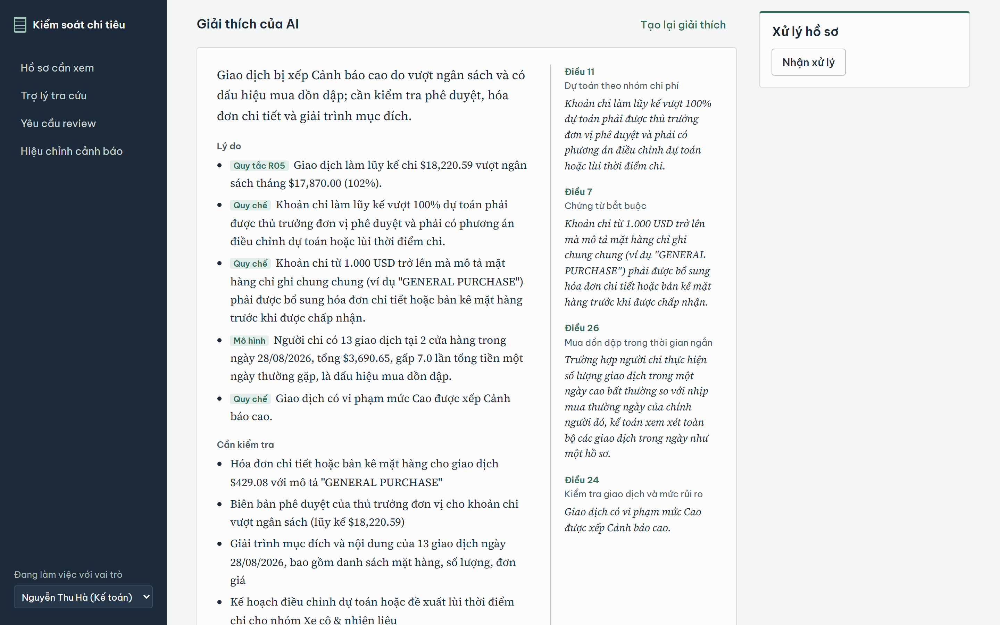
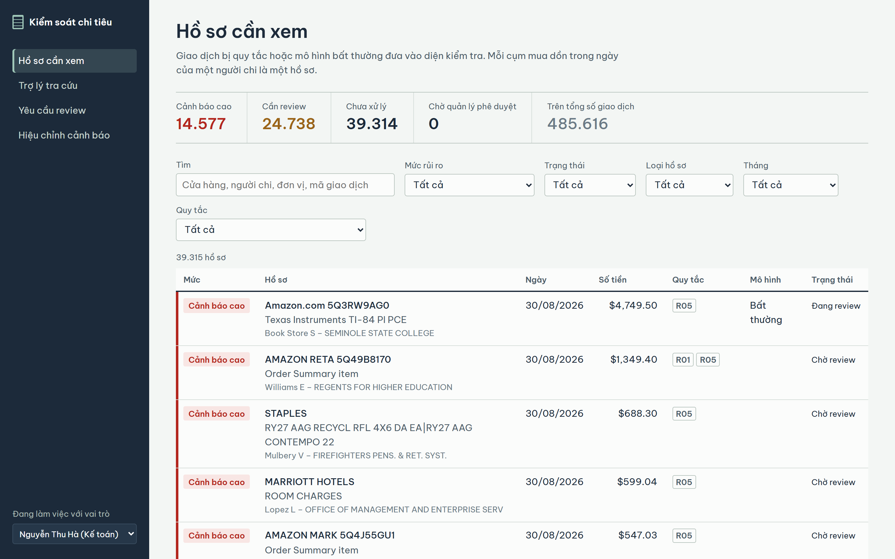
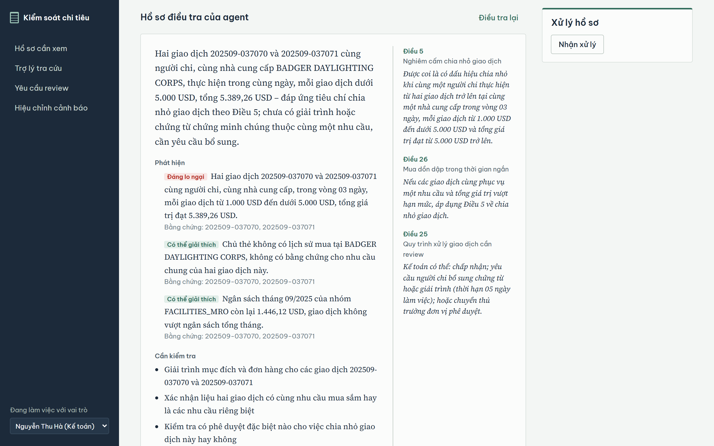
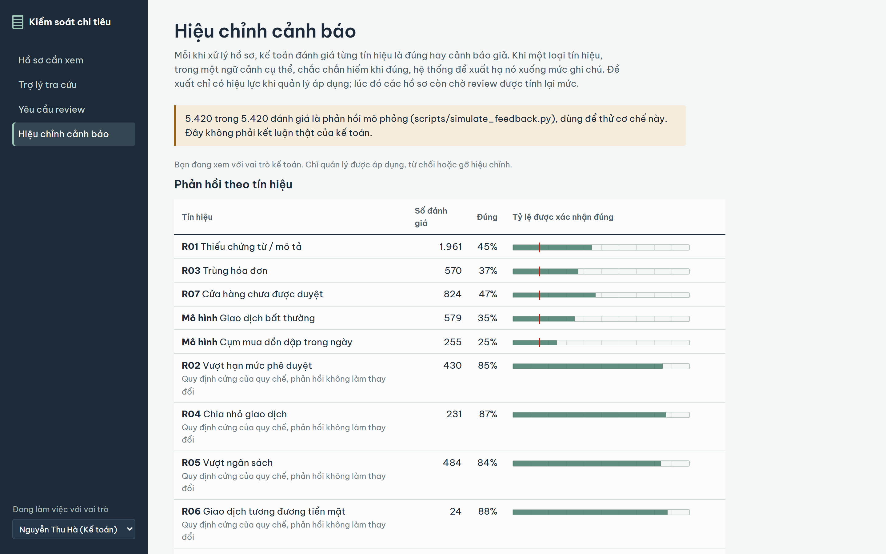
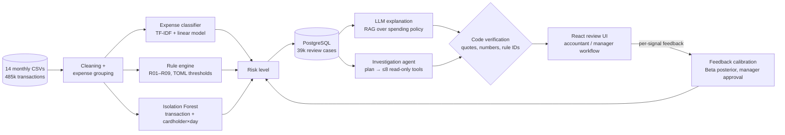

# Spend Control AI — transaction review for purchase-card spending

> Graduation thesis (HUST SoICT, 2026): *An AI application to support analysis and checking of financial transactions.*
> Runs on **485,616 real public transactions** (State of Oklahoma purchase cards, 07/2025 – 08/2026), not synthetic data.

The system helps an accountant decide which card transactions need a closer look, and why.
Deterministic rules handle everything that can be stated exactly; machine learning and LLMs are used only
where rules cannot do the job, and every LLM output is checked by code before it is shown.
The final decision always stays with a human.



| Review queue (39k cases) | Investigation agent report | Feedback calibration |
|:-:|:-:|:-:|
|  |  |  |

*The UI is in Vietnamese, the thesis language.*



## Results

All numbers come from the notebooks in `notebooks/` and can be reproduced.

| Component | Method | Result |
|---|---|---|
| Expense classification (16 groups) | TF-IDF on description + merchant, plus agency and amount | **95.0% accuracy, 94.1% macro-F1** (merchant-lookup baseline: 88.9% / 91.0%); unseen merchants **72.8%** vs 11.5% |
| Rule engine (9 business rules) | pandas, thresholds in `config/rules.toml` | All 485,616 transactions in ~8 s; 3.4% end up as high alert |
| Anomaly detection | Isolation Forest, 8 behavioural features, SHAP explanations | ROC-AUC **0.870**, PR-AUC 0.187 on 1,596 injected anomalies; catches 44% in the top 3% (z-score baseline: 13%) |
| Policy retrieval (26-article policy, 50 questions) | BM25 (syllable bigrams) + MiniLM embeddings, reciprocal rank fusion | Recall@3 **0.91**, Recall@5 **0.97**, MRR 0.844 |
| LLM explanations (16 cases, gpt-oss-120b on Groq) | Strict JSON schema, citations restricted to retrieved articles | 16/16 valid JSON, **97% of citations verified verbatim**, 100% of rule violations covered |
| LLM vs code for rule checking (44 transactions) | Same rule spec given to the LLM | LLM 89%, code 100% — and the disagreement exposed a real bug in the code (below) |
| Investigation agent vs single-step (6 cases) | Planner + read-only tools + self-correction round | Cites 4.0 related transactions per case (single step: 0.17); weighs mitigating factors in 4/6 cases (0/6); costs ~5.9× tokens |

### Things the evaluation caught

- **A silent rule bug.** Comparing LLM rule-checking against the code showed the "split purchase" rule (R04) was wrong:
  `groupby(...).rolling()` returned rows in group order, not input order, so 1,719 transactions were flagged by mistake
  and 1,719 were missed (the total count looked correct). Fixed with a binary-search window in `src/window.py` plus a
  regression test that shuffles group order.
- **Arithmetic hallucinations.** The assistant computed a budget remainder off by $100, and the explainer mixed a
  month-to-date total with a point-in-time percentage. Fix: tools return pre-computed values, and a verifier checks that every
  amount and percentage in the output matches a value in the case, the policy, or a tool result.
- **An inflated headline.** The first feedback-learning simulation counted transactions instead of review cases, which
  inflated the false-alert reduction (35%). After the fix, the reported figure is 7.6% at the default risk threshold.

## Features

- **Review workflow** following the business analysis: New → In review → Accepted / Needs documents / Needs approval → Approved / Rejected.
  High-alert cases cannot be accepted by an accountant; only a manager can approve or reject; every change is audit-logged.
- **AI explanation** of each case with policy citations shown in the margin, kept separate from the code's own findings.
- **Tool-calling assistant** (5 tools). It can *propose* a review request, but nothing is saved until a human confirms.
- **Investigation agent** running as a background job with step-by-step progress; evidence and recommended actions are
  constrained by enums to transactions it actually read and actions that are valid in the current state.
- **Learning from accountant feedback:** per-signal "correct / false alert" ratings feed a Beta posterior per context.
  The system *suggests* downgrading a signal only when P(precision < τ) ≥ 95%, accounts for reviewer error, never touches
  hard-policy rules, and requires manager approval.

## Tech stack

Python 3.13 · pandas · scikit-learn · SHAP · fastembed (ONNX) · rank-bm25 · Groq (gpt-oss-20b / 120b) ·
FastAPI · SQLAlchemy 2 · PostgreSQL 17 · React + Vite + TypeScript · pytest (77 tests)

## Run it

```bash
python -m venv .venv
.venv\Scripts\python -m pip install -r requirements.txt
copy .env.example .env                      # add GROQ_API_KEY (free tier is enough)

docker compose up -d                        # PostgreSQL on port 5433
.venv\Scripts\python scripts\load_db.py     # rules + models over all data, ~2 minutes
.venv\Scripts\python -m uvicorn app.main:app --port 8000

cd web && npm install && npm run dev        # http://localhost:5173
```

The models in `models/` are not committed; generate them by running `notebooks/02_classification.ipynb` and `04_anomaly.ipynb`.
Tests: `.venv\Scripts\python -m pytest tests -q`.

## Repository layout

```
src/        data loading, features, rules, anomaly, risk, RAG, LLM, assistant, agent, feedback
app/        FastAPI backend, review workflow, calibration
web/        React review UI
notebooks/  01 EDA → 08 feedback: every reported number comes from here
config/     rule thresholds and feedback parameters
data/       raw public data, spending policy, evaluation sets, recorded LLM runs
tests/      77 tests (rules, anomaly, LLM verification, agent, API, feedback)
```

## Limitations

- The UI and the sample spending policy are in Vietnamese (the thesis language); the source data is in English.
- Budgets and the approved-merchant list are generated from historical spending, because the State does not publish them.
- There are no real fraud labels: anomaly detection is evaluated on injected anomalies, and the feedback loop on a simulated reviewer.
- No authentication yet; the role is chosen in the UI.
- The agent and LLM experiments are small (6–44 cases) because of the Groq free-tier limits.

## Data

Oklahoma Office of Management and Enterprise Services, Purchase Card (PCard) data, published on data.ok.gov.
See [data/README.md](data/README.md) for the format quirks that the loader handles.
